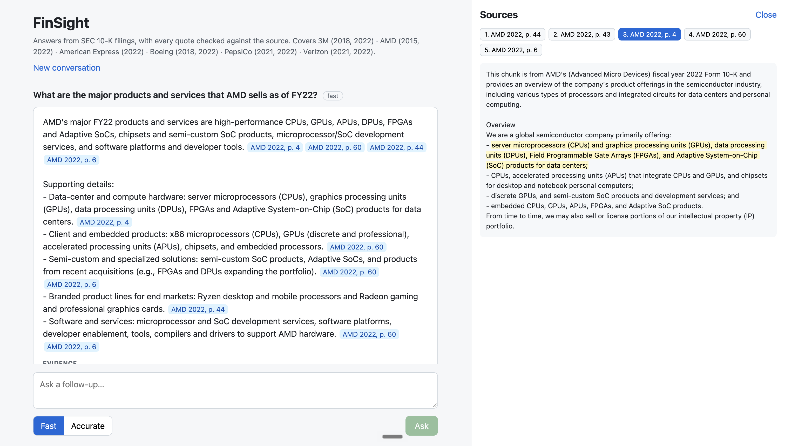
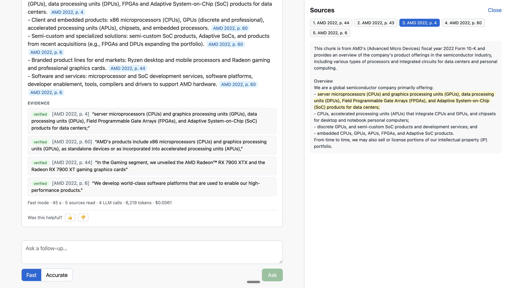
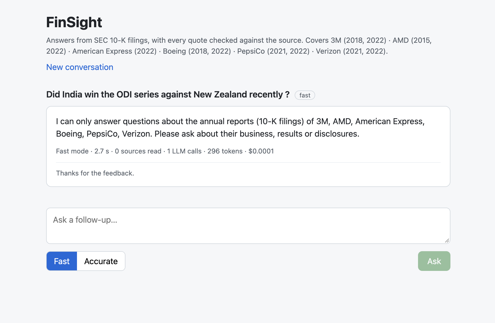
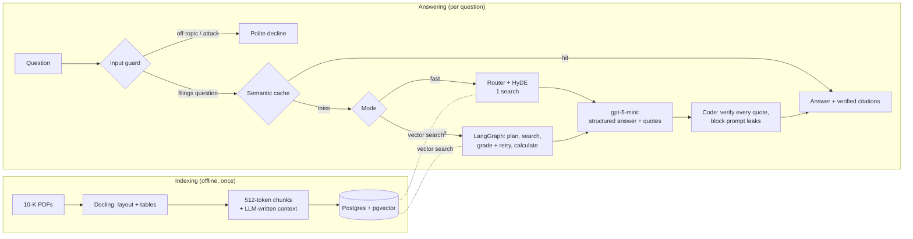

# FinSight: an end-to-end RAG project you can learn from, run and extend

[](https://github.com/SaiAbhinivesh/finsight-rag/actions/workflows/ci.yml)
[](LICENSE)

**Ask questions about companies' annual reports (SEC 10-K filings) and get answers whose every quote is checked against the source.**

FinSight is a complete RAG (Retrieval-Augmented Generation) system built with LangChain and LangGraph, from PDF parsing to a streaming web app with an evaluation gate in CI. It was built in 11 milestones, each changing one layer and measured on the same 45-question test set, and every milestone is documented so you can follow along.

**This repository is for you if you want to:**

- **Learn RAG end to end** with a real, hard dataset: ingestion, chunking, embeddings, retrieval, reranking, grounded generation, agents, evaluation, guardrails, cost tracking, CI.
- **Build it yourself, step by step:** the [build guide](docs/BUILD_GUIDE.md) and [milestone notes](docs/milestones/) walk through every step, with the results to expect.
- **Fork it and build on top:** clean modules, unit tests and an evaluation gate tell you whether your change helped ([ideas](docs/IDEAS.md)).
- **Prepare for AI-engineering interviews:** an [interview guide](docs/INTERVIEW_GUIDE.md) with common RAG questions answered using this project's measurements.

| | Naive RAG (M1) | FinSight (M10) |
| --- | --- | --- |
| Correct answers on FinanceBench questions | 7 / 39 | **34 / 39** (accurate mode), 25-28 / 39 (fast mode) |
| Questions with no answer in the filings, correctly declined | 6 / 6 | 6 / 6 |
| Citations whose quote is found word for word in the source | not checked | **97%** |
| Prompt-injection and misuse attacks handled | not tested | **16 / 16** |
| Cost and time per answer | not tracked | ~$0.005, ~25-30 s (fast) · ~60 s (accurate) · 0.1 s when cached |

## Demo

| Click any citation: the source chunk opens with the quote highlighted | Every quote is checked word for word; cost and time per answer |
| --- | --- |
|  |  |



Ask a question, pick **Fast** (one search) or **Accurate** (plans, searches several times, calculates; its steps appear live), click any citation to open the chunk it came from, ask follow-ups, and rate the answer. Questions outside the filings are declined by the input guard before any retrieval runs.

## How it works



- **Ingestion:** Docling keeps financial tables intact; each chunk gets an LLM-written sentence saying which company, year and section it comes from (contextual retrieval: hit@5 0.33 → 0.59 on its own).
- **Retrieval:** an LLM router restricts search to the right company and fiscal year, and HyDE searches with a hypothetical 10-K passage instead of the raw question. Hybrid keyword search and cross-encoder reranking were tested and **rejected** (both measured worse on this data).
- **Generation:** gpt-5-mini returns a structured `Answer` (text, answerable flag, citations with exact quotes); code verifies every quote against its chunk and renders `[Company Year, p. N]` labels.
- **Accurate mode:** a LangGraph workflow plans the facts it needs, searches for each, grades whether everything was found (retrying with new queries up to twice), computes with a safe calculator and checks grounding. A free ReAct agent reached the same accuracy but needed code-enforced limits to stop looping.
- **Production:** per-request cost and latency tracking, a semantic answer cache, an input guard + hardened prompt + output leak check, Docker images, and CI that blocks pull requests which lower accuracy or safety.

## What you'll learn, milestone by milestone

| Milestone | Topic | Concepts |
| --- | --- | --- |
| [M0](docs/milestones/M0-setup.md) | Setup and data | uv, Postgres + pgvector in Docker, FinanceBench, metadata schema |
| [M1](docs/milestones/M1-naive-rag.md) | Naive RAG baseline | Loaders, chunking, embeddings, vector search, LCEL chain, citations |
| [M2](docs/milestones/M2-evaluation.md) | Evaluation harness | Golden set, hit@k / MRR, LLM-as-judge, RAGAS, noise |
| [M3](docs/milestones/M3-ingestion.md) | Better ingestion | Docling, table-aware chunking, contextual retrieval, incremental indexing |
| [M4](docs/milestones/M4-retrieval.md) | Better retrieval | Metadata router, hybrid search + RRF, HyDE |
| [M5](docs/milestones/M5-reranking.md) | Reranking | Cross-encoders, two-stage retrieval (and why it lost here) |
| [M6](docs/milestones/M6-generation.md) | Grounded generation | Prompt design, reasoning models, structured output, verified citations, follow-ups |
| [M7](docs/milestones/M7-agents.md) | Agentic RAG | Tools, ReAct agent, LangGraph corrective-RAG workflow, calculator |
| [M8](docs/milestones/M8-api-ui.md) | API and UI | FastAPI, Server-Sent Events, React, user feedback in LangSmith |
| [M9](docs/milestones/M9-production.md) | Production | Cost and latency tracking, semantic cache, prompt-injection defences, Docker |
| [M10](docs/milestones/M10-ci.md) | Quality automation | Unit tests, GitHub Actions, an evaluation gate |

## Run it

**Fastest way in: the [quick tour](docs/QUICK_TOUR.md)** indexes 2 filings and has FinSight answering in the terminal and the web UI in about 20 minutes, for ~$0.20.

**The full build (11 filings).** What you need: Docker Desktop, [uv](https://docs.astral.sh/uv/), Node.js 20+, an OpenAI API key, optionally a free LangSmith key. Building the index costs about $1 of API usage and ~1 hour of PDF parsing (once); a full evaluation run costs ~$0.30.

```bash
git clone https://github.com/SaiAbhinivesh/finsight-rag.git finsight && cd finsight
cp .env.example .env                       # add your OpenAI (and optionally LangSmith) key
docker compose up -d db                    # Postgres + pgvector on localhost:6024
uv sync                                    # Python 3.12 + all dependencies

uv run python scripts/download_filings.py  # the 11 10-K PDFs
uv run python scripts/smoke_test.py        # model, embeddings and database all reachable
uv run python scripts/parse_docling.py     # parse once (~1 hour, cached)
LANGSMITH_TRACING=false uv run python scripts/ingest.py --loader docling --drop-exhibits --context llm --table chunks_live --incremental

uv run python -m finsight.ask "What production rate changes is Boeing forecasting for FY2023?"
uv run python -m finsight.ask --graph "What is the FY2022 unadjusted EBITDA % margin for PepsiCo?"
```

Then the whole app with one command (UI http://localhost:5173, API http://localhost:8000/docs):

```bash
docker compose up --build
```

Every command, option and troubleshooting tip: [docs/GETTING_STARTED.md](docs/GETTING_STARTED.md).

## Test and evaluate

| Check | Command | Cost |
| --- | --- | --- |
| Lint + 47 unit tests | `uv run ruff check src eval scripts tests` · `uv run pytest` | Free, seconds |
| Frontend type check + build | `cd frontend && npm run build` | Free |
| Retrieval metrics (hit@k, MRR) | `uv run python eval/retrieval_metrics.py --run my_run` | ~free |
| Answer scorecard (judge + RAGAS) | `uv run python eval/run_answers.py --run my_run` then `eval/score_answers.py --run my_run` | ~$0.30 |
| Red-team safety suite (16 attacks) | `uv run python eval/safety_eval.py --run my_safety` | ~$0.10 |
| Everything with pass/fail thresholds | `uv run python eval/gate.py --run my_gate` | ~$0.35 |

GitHub Actions runs lint, tests and the frontend build on every push. The evaluation gate runs in CI too once you add your OpenAI key and index to your fork ([how](docs/GETTING_STARTED.md#12-tests-and-ci-m10)). Compare your numbers with [EXPERIMENTS.md](docs/EXPERIMENTS.md).

## Results by milestone

All runs use the same 39 FinanceBench questions + 6 unanswerable ones ([every run, with diagrams](docs/EXPERIMENTS.md)).

| Milestone | What changed | hit@5 | Correct / 39 |
| --- | --- | --- | --- |
| M1 | Naive RAG: PyPDF, 1000-char chunks, top-5 vector search, gpt-4o-mini | 0.36 | 7 |
| M3 | Docling parsing + LLM chunk context (contextual retrieval) | 0.59 | 15 |
| M4 | Company/year router + HyDE | 0.74 | 18 |
| M5 | Cross-encoder reranking (tested, rejected) | 0.72 | — |
| M6 | Analyst prompt + gpt-5-mini + structured answers with verified citations | = M4 | 29 |
| M7 | Multi-step: ReAct agent and LangGraph workflow with calculator | multi-search | **34** |
| M9 | Security rules in the prompt (fast mode, no accuracy loss) | = M4 | 25 |
| M10 | CI eval gate on a fresh machine (fast mode) | = M4 | 27 |

Fast-mode runs vary by about ±2-3 questions between identical runs ([M2 notes](docs/milestones/M2-evaluation.md)); nine hard questions are followed through every milestone in [EXPERIMENTS.md](docs/EXPERIMENTS.md).

## Tech stack

| Layer | Choice |
| --- | --- |
| Language, packages | Python 3.12, uv (dependency groups: serving / ingest / eval / rerank / dev) |
| LLM framework | LangChain 1.x, LangGraph |
| Models | OpenAI `gpt-5-mini` (answers, grading), `gpt-4o-mini` (router, HyDE, planning, guard), `gpt-4.1-mini` (judge), `text-embedding-3-small` |
| Parsing | Docling (layout + tables), HybridChunker |
| Storage | Postgres 16 + pgvector: vectors, chat history, request log, answer cache |
| Indexing | LangChain Indexing API (incremental, `SQLRecordManager`) |
| API, UI | FastAPI + Server-Sent Events · React + TypeScript (Vite) |
| Observability | LangSmith traces + user feedback, LangChain callbacks → `request_log` |
| Evaluation | FinanceBench, LLM judge, RAGAS, exact-quote citation checks, red-team suite |
| Delivery | Docker Compose, GitHub Actions (CI + eval gate) |

## Key lessons from the build

- **Measure every change.** Several "best practices" lost on this data: hybrid search (hit@5 0.72 → 0.62), cross-encoder reranking, 256- and 1024-token chunks. Contextual retrieval, metadata filters and HyDE won.
- **Retrieval sets the ceiling, generation decides how close you get.** The right prompt and a reasoning model turned refusals into answers (+9 correct) without more wrong ones; multi-step retrieval then fixed answers whose inputs sat on different pages (+10).
- **Agents need limits in code.** A prompt that says "max 6 searches" is a suggestion; a budget inside the tool is a rule.
- **Make answers checkable.** Structured output + exact-quote verification turns "the model cited something" into a free, deterministic metric.
- **Evaluate the evaluation.** The judge mislabelled refusals, keyword safety checks misread honest answers, and a substring check let invented numbers pass; each was found by reading failures, and fixed.
- **Production is its own set of trade-offs:** a semantic cache is risky when one word changes the answer, a guard needs a false-positive test, and a docs-only change should not cost an LLM evaluation.


## Project structure

```text
src/finsight/
  ingestion/       PDF loading (PyPDF, Docling), chunking, LLM chunk context
  indexing/        pgvector store, incremental indexing
  retrieval/       router (company/year filters), HyDE, keyword search + RRF, reranking
  generation/      prompts (v1-v3), structured answers + citation checks, follow-ups, RAG chain
  agent/           search + calculator tools, ReAct agent, LangGraph workflow
  cache/           semantic answer cache
  safety/          input guard, output leak check, grounding checks
  observability/   prices, token/cost/latency tracking, request log
  service.py       one entry point: guard -> cache -> fast / accurate -> output check
  api/             FastAPI: /ask, /ask/stream (SSE), /feedback, /filings
frontend/          React + TypeScript UI
eval/              golden set, retrieval metrics, scorecard, safety suite, cache sweep, eval gate
tests/             unit tests
docs/              build guide, milestone notes, experiments, architecture, decisions, glossary, interview guide
.github/workflows/ CI and eval gate
```

## Documentation

| Read | For |
| --- | --- |
| [Quick tour](docs/QUICK_TOUR.md) | Running it in ~20 minutes on 2 filings |
| [Getting started](docs/GETTING_STARTED.md) | The full build: every command, option and fix |
| [Build guide](docs/BUILD_GUIDE.md) | Building it yourself, milestone by milestone |
| [Milestone notes](docs/milestones/) | What each milestone did, results, lessons, gotchas |
| [Experiments](docs/EXPERIMENTS.md) | Every run as a diagram, with numbers before and after |
| [Architecture](docs/ARCHITECTURE.md) | How one request flows through the code; where to change what |
| [Decisions](docs/DECISIONS.md) | Why each technical choice was made |
| [Glossary](docs/GLOSSARY.md) | RAG concepts in two lines each, mapped to the code |
| [Interview guide](docs/INTERVIEW_GUIDE.md) | RAG interview questions answered with real numbers |
| [Ideas](docs/IDEAS.md) | What to build next |
| [AGENTS.md](AGENTS.md) / [CLAUDE.md](CLAUDE.md) | Guidance for AI coding agents (Claude Code, Codex, Cursor) working in the repo |

## Build on top of it

The build ends at M10. If you fork it, these are the natural next steps, ranked (details and more in [docs/IDEAS.md](docs/IDEAS.md)):

| Area | Idea | Why |
| --- | --- | --- |
| Quality | Grow the golden set to 150+ questions and more companies | 39 questions means ±2-3 questions of noise per run |
| Quality | Claim-level citation checks (does the quote *support* the sentence, not just exist?) | Today quotes are verified to exist in the source |
| Quality | Retry hybrid search with keywords extracted from the question; a long-input reranker | Both failed for specific, fixable reasons (noisy long questions, 512-token limit) |
| Speed | Route questions automatically to fast or accurate mode; parallel searches in the graph; stream the answer then verify | Accurate-mode quality at closer to fast-mode latency |
| Scale | Parallel parsing, batch embeddings, HNSW on the chunk table, a router that doesn't list every filing | From 11 filings to thousands |
| Product | Public demo deploy with rate limiting; users uploading their own filings; a dashboard over cost and latency | A live link; real traffic for the feedback loop |
| Learning | GraphRAG over entities and relations, multimodal RAG over charts, fine-tuned embeddings, an MCP server for `search_filings` | Techniques the plan touched only as stretch goals |

Every one of these can be judged the same way the rest of the project was: change one thing, run the eval gate, keep it only if the numbers say so.

## Data, credits and licence

Questions, reference answers and filings come from the [FinanceBench](https://github.com/patronus-ai/financebench) open-source sample by Patronus AI (11 filings of 3M, AMD, American Express, Boeing, PepsiCo and Verizon), licensed for **noncommercial use**; PDFs are downloaded by script, not stored in this repository. The code is MIT-licensed ([LICENSE](LICENSE)).

Built by [SaiAbhinivesh](https://github.com/SaiAbhinivesh). If it helped you learn or you built something on top of it, a star or a link back is appreciated.
