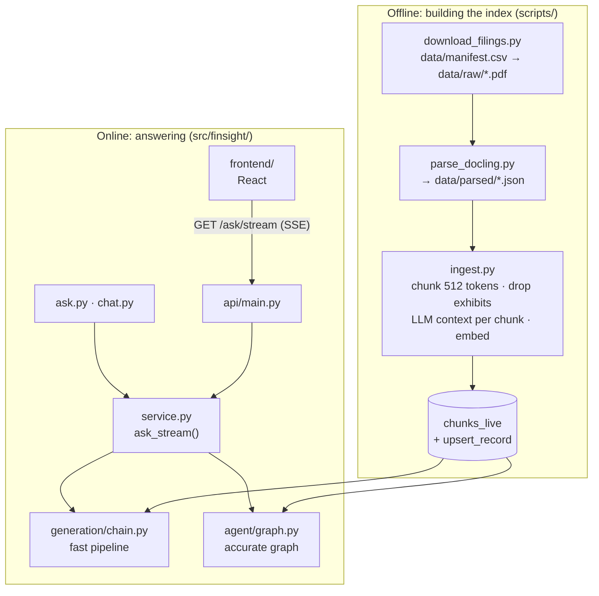
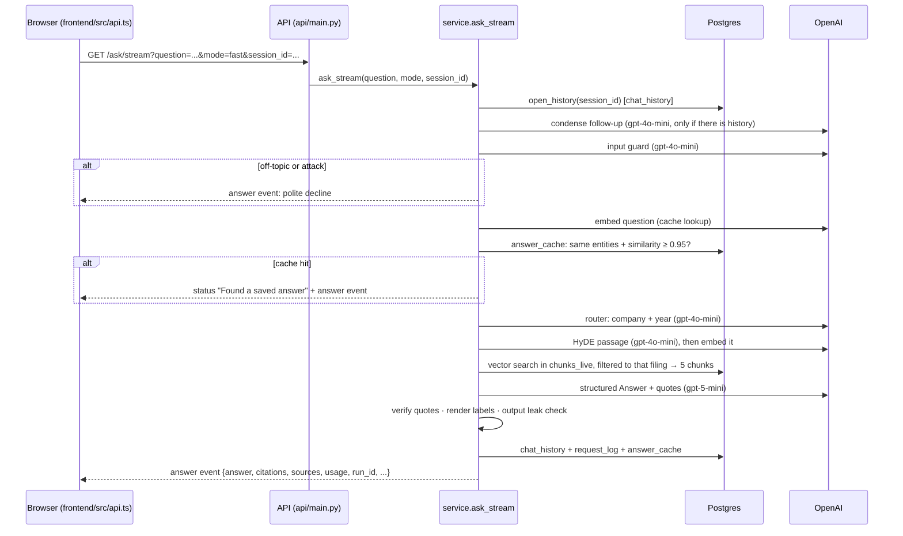

# Architecture: how FinSight works, module by module

Read this when you come back to the project after a while. It follows one question from the browser to the answer, then lists the database tables and where to change what.

## The big picture

## The life of one question

In **accurate** mode the router + HyDE + single search are replaced by the LangGraph workflow (`agent/graph.py`): plan (gpt-4o-mini) → retrieve (code, one filtered search per fact) → grade (gpt-5-mini; up to 2 retry rounds) → calculate (gpt-5-mini writes formulas, code computes) → generate (gpt-5-mini) → check (code). Each node's progress is streamed as a `status` event.

Feedback: `POST /feedback {run_id, score, comment}` → LangSmith `create_feedback` on that trace; a 👎 also removes the answer from `answer_cache`.

## Step by step, with the file that does it

| Step | File · function | Model / store | Notes |
| --- | --- | --- | --- |
| Validate input | `api/main.py` | | 3-1000 characters, mode `fast` / `accurate` |
| Session + history | `generation/conversation.py` · `open_history` | `chat_history` | New session id when none is given |
| Follow-up rewrite | `conversation.py` · `condense` | gpt-4o-mini | Skipped on the first question |
| Input guard | `safety/guard.py` · `check_input` | gpt-4o-mini | Fails open; "on topic" = about a company |
| Cache | `cache/semantic_cache.py` · `lookup` / `store` | embeddings + `answer_cache` | Entity key first, then similarity |
| Router | `retrieval/filters.py` · `extract_filters` | gpt-4o-mini | Validated against `data/manifest.csv`; unfiltered fallback |
| HyDE | `retrieval/rewrite.py` · `hyde` | gpt-4o-mini | The passage is only used for searching |
| Search | `retrieval/retrievers.py` · `search` | `chunks_live` | Optional hybrid (`keyword.py`) and rerank (`rerank.py`), both off |
| Answer | `generation/chain.py` + `structured.py` | gpt-5-mini | Prompt v3 (`prompts.py`) |
| Quote check | `structured.py` · `verify_citations` | code | Whitespace/case-insensitive substring of the named block |
| Leak check | `safety/guard.py` · `leaked` | code | Canary + prompt phrases |
| Usage | `observability/usage.py` · `UsageTracker` | callbacks | Tokens, reasoning tokens, cost, time per call |
| Log | `observability/request_log.py` | `request_log` | Never raises |

## Database tables (Postgres + pgvector, one database)

| Table | Written by | Holds |
| --- | --- | --- |
| `chunks_live` | `scripts/ingest.py --incremental` | The index: chunk text (with its LLM context), embedding (1536 floats), metadata columns (doc_name, company, ticker, fiscal_year, doc_type, sector, page) |
| `upsert_record` | LangChain `SQLRecordManager` | Which chunks are indexed, so re-ingesting adds only new or changed ones |
| `chunks_baseline`, `chunks_docling*`, `chunks_ctx_*` | Earlier experiments (M1, M3) | Kept for reproducing old runs; safe to drop |
| `chat_history` | `conversation.py` | Messages per session id |
| `request_log` | `observability/request_log.py` | One row per answer: mode, seconds, LLM calls, tokens, cost, cached, timings |
| `answer_cache` | `cache/semantic_cache.py` | Saved answers with question embedding (HNSW index), entity key, hits |

Inspect any of them: `docker exec finsight-db psql -U finsight -d finsight -c "\d+ request_log"`.

## Where to change what

| I want to... | Change | Then check with |
| --- | --- | --- |
| Change the answer prompt | `generation/prompts.py` (add a version; `structured.py` picks the one used) | `eval/run_answers.py` + `score_answers.py`, safety suite |
| Change a model | `.env` (`CHAT_MODEL`, `ANSWER_MODEL`, `JUDGE_MODEL`); prices in `observability/pricing.py` | Scorecard + `usage_report.py` |
| Add or remove a filing | `data/manifest.csv`, then download, parse and `ingest.py --incremental` (clears the cache) | `retrieval_metrics.py`; new CI index release |
| Retrieval options | `retrieval/retrievers.py` (`build_retriever` defaults) | `retrieval_metrics.py` |
| Graph behaviour (retries, prompts) | `agent/graph.py` (`MAX_RETRIES`, prompts, which model per node) | `run_answers.py --graph` |
| Agent limits | `agent/tools.py` (`MAX_SEARCHES`), `simple_agent.py` (`max_steps`) | `run_answers.py --agent` |
| Cache strictness | `cache/semantic_cache.py` (`SIMILARITY_THRESHOLD`, `TTL_DAYS`) | `eval/cache_eval.py` |
| Guard behaviour | `safety/guard.py` | `safety_eval.py --golden` and the attack suite |
| Gate thresholds | `eval/gate_baseline.json` | `eval/gate.py` |
| UI | `frontend/src/` (`App.tsx`, `components/`) | `npm run build` |

## Configuration

All settings come from `.env` through `config.py` (`Settings`): `OPENAI_API_KEY`, `DATABASE_URL`, `CHAT_MODEL`, `ANSWER_MODEL`, `EMBEDDING_MODEL`, `JUDGE_MODEL`, `LANGSMITH_*`. Real environment variables win over `.env` (that is how Docker and CI override `DATABASE_URL`).
