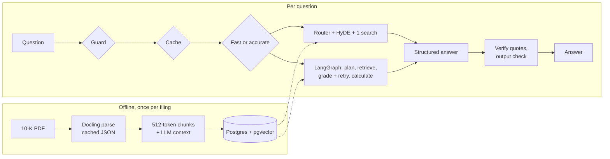

# Build guide: FinSight step by step

This is the plan FinSight was built from (written before any code), updated after the build so you can follow it step by step. Each milestone keeps its original goal and steps, corrected where reality differed, and ends with **What happened**: the result, what surprised us, and a link to the full milestone notes.

How to use it: do the milestones in order. For each one, read the goal, do the steps yourself, measure, then compare with "What happened". Your numbers will differ a little (LLM runs vary by ±2-3 questions); the direction of each change should not.

## The project

Build **FinSight**, a question-answering assistant over public-company annual reports (SEC 10-K filings) that answers with page-level citations and proves its quality with an evaluation harness. Build it in 11 milestones (M0-M10): start with a naive RAG pipeline, then upgrade one layer at a time and measure every upgrade.

Example questions it should handle (from the filings actually used: 3M, AMD, American Express, Boeing, PepsiCo, Verizon):

- "What was 3M's capital expenditure in FY2018?" (single fact, lives in a table)
- "What production rate changes is Boeing forecasting for FY2023?" (prose spread over pages)
- "What is the FY2022 unadjusted EBITDA % margin for PepsiCo?" (two statements + a calculation: needs multi-step retrieval)
- "What is Verizon's dividend policy for 2030?" (should be declined: not in the filings)

Why 10-K filings and not a generic "chat with your PDF":

- They are hard the way real enterprise documents are hard: 100+ pages, dense tables, boilerplate, the same terms across many companies. Naive RAG visibly fails, so every upgrade shows a measurable win.
- They are public (SEC EDGAR).
- A ground-truth test set exists: **FinanceBench** (Patronus AI) has open-source question / answer / evidence-page triples over 10-Ks, so you get real numbers instead of impressions.

What makes it resume-grade rather than tutorial-grade: a results table showing how each technique moved the metrics (including the ones that made things worse), structured answers whose citations are verified in code, an evaluation gate in CI, tracing, and a working UI.

**Budget:** about $5-10 of OpenAI usage for the whole build (the LLM-written chunk context ~$0.70 once; a full 45-question scorecard ~$0.25-0.35). **Time:** 3-5 weeks part-time; each milestone 2-8 hours.

## Concept map: every RAG idea and where you touch it

| Layer | Concept | Milestone | In this repo |
| --- | --- | --- | --- |
| Ingestion | Document loaders, LangChain `Document`, metadata | M1, M3 | PyPDF, then Docling |
| Ingestion | Layout-aware PDF parsing with tables (Docling) | M3 | Kept |
| Ingestion | Chunking strategies (recursive, structure-aware; sizes) | M3 | 512-token Docling chunks; 256 / 1024 measured, no gain |
| Ingestion | Contextual retrieval (LLM-written context per chunk) | M3 | Kept: biggest single search gain |
| Ingestion | Incremental indexing (Indexing API, record manager) | M3 | Kept (`chunks_live`) |
| Indexing | Embeddings, cosine similarity | M1 | `text-embedding-3-small` |
| Indexing | Vector database, HNSW (pgvector) | M1, M9 | pgvector; HNSW on the answer cache |
| Indexing | Keyword index (Postgres full-text) | M4 | Built, used for the hybrid experiment |
| Retrieval | Dense top-k search | M1 | Kept |
| Retrieval | Hybrid search with Reciprocal Rank Fusion | M4 | Hand-written RRF; **rejected** (worse) |
| Retrieval | Metadata filtering / self-query (company, year) | M4 | Kept: LLM router + code guardrails |
| Retrieval | Query transformation (HyDE) | M4 | Kept |
| Post-retrieval | Cross-encoder reranking | M5 | Two models tested; **rejected** (worse) |
| Generation | Grounded prompting, refusal | M1, M6 | Strict v1 → analyst v2 → secure v3 |
| Generation | Structured output, verified citations | M6 | Kept: exact-quote check in code |
| Generation | Conversation memory, question condensing | M6 | Kept (Postgres chat history) |
| Agentic | Tool-using agent (`create_agent`, `@tool`) | M7 | Kept as `--agent` |
| Agentic | LangGraph workflow: plan, grade, retry, check (corrective RAG) | M7 | Kept as `--graph` (accurate mode) |
| Agentic | Query decomposition, calculator tool | M7 | Kept |
| Evaluation | Golden dataset (FinanceBench + unanswerable) | M2 | 39 + 6 questions |
| Evaluation | Retrieval metrics: hit@k, recall@k, MRR | M2 | Kept |
| Evaluation | RAGAS (faithfulness, context precision / recall) | M2 | Kept (noisy for calculations) |
| Evaluation | LLM-as-judge and its biases | M2 | Judge + rules for refusals |
| Evaluation | Ablations with control runs | M3-M7 | Every milestone |
| Production | Tracing and user feedback (LangSmith) | M8 | Kept |
| Production | Streaming API (FastAPI + SSE), React UI with citations | M8 | Kept |
| Production | Cost / latency tracking, semantic cache | M9 | Kept |
| Production | Prompt injection, guardrails, red-team tests | M9 | Kept: 16/16 attacks |
| Production | Containers, CI, evaluation gate | M9, M10 | Kept |

Stretch topics (optional): GraphRAG, multimodal RAG over charts, embedding fine-tuning, late chunking, an MCP server exposing `search_filings`.

## Tech stack

| Piece | Planned | Used | Why |
| --- | --- | --- | --- |
| Language / env | Python 3.12, uv | Same | AI ecosystem is Python-first; uv is fast and reproducible |
| Orchestration | LangChain 1.x | Same (`init_chat_model`, `init_embeddings`, `create_agent`, LCEL) | Project requirement. Avoid old tutorials using `LLMChain` / `RetrievalQA` / `AgentExecutor` |
| Agent graphs | LangGraph | Same | `create_agent` runs on it; the corrective-RAG workflow is a hand-built `StateGraph` |
| PDF parsing | Docling via `DoclingLoader` | Docling directly, parsed JSON cached | Parsing is ~1 s/page; caching lets chunking experiments re-run instantly |
| Vector + keyword store | Postgres 16 + pgvector (langchain-postgres) | Same | One database for vectors, full-text, metadata, chat history, logs and cache |
| Embeddings | OpenAI `text-embedding-3-small`, compare a local BGE | OpenAI only | One API key; the comparison was dropped to keep focus |
| Chat models | One small cheap model | `gpt-4o-mini` for helper steps, `gpt-5-mini` for answers and grading, `gpt-4.1-mini` as judge | A reasoning model turned refusals into correct answers (M6) |
| Reranker | Local cross-encoder | Tested (MiniLM, bge-reranker-base), off by default | Measured worse on this data |
| Evaluation | RAGAS + own retrieval metrics + FinanceBench | Same + LLM judge + code checks | |
| Tracing | LangSmith | Same, plus user feedback on traces | |
| API / UI | FastAPI + SSE, React + Vite + TypeScript | Same | |
| Cache | Redis | Postgres + pgvector | One database; the cache needs vector search anyway |
| Packaging / CI | Docker Compose, GitHub Actions | Same | |
| Deploy | Free tier host | Not done (optional) | |

LangChain moves fast: before each milestone check the current docs page for the class you use, and pin versions once things work.

## Architecture (as built)



## Repo structure (as built)

```text
finsight/
  pyproject.toml              # dependencies; groups: ingest, eval, rerank, dev
  docker-compose.yml          # db + api + ui
  Dockerfile                  # API image (serving dependencies only)
  .env.example
  data/
    manifest.csv              # the 11 filings
    raw/  parsed/             # PDFs, Docling JSON + cached contexts (gitignored)
    eval/golden_set.jsonl     # 39 FinanceBench + 6 unanswerable questions
  src/finsight/
    config.py                 # pydantic-settings from .env
    ingestion/                # loaders (PyPDF, Docling), chunkers, contextualize
    indexing/                 # pgvector store, incremental indexing
    retrieval/                # filters (router), rewrite (HyDE), keyword + RRF, rerank, retrievers
    generation/               # prompts, models, structured answers, conversation, chain
    agent/                    # tools, simple_agent (ReAct), graph (LangGraph)
    cache/  safety/  observability/
    service.py                # one entry point for CLI, API and UI
    api/main.py               # FastAPI
    ask.py  chat.py           # command line
  frontend/                   # React + Vite + TypeScript
  eval/                       # build_golden_set, retrieval_metrics, run/score answers, safety, cache, gate
  scripts/                    # download_filings, parse_docling, ingest, smoke_test
  tests/                      # unit tests
  docs/                       # this guide, milestone notes, experiments, decisions, architecture
  .github/workflows/          # ci.yml, eval-gate.yml
```

## Milestones

**The golden rule:** build a simple version end to end first, measure it, then upgrade one layer at a time and re-measure after every change. Keep the changes that win, write down the ones that lose, and say why.

### M0. Setup and data (2-3 hours)

Goal: a runnable repo, a database and real filings on disk.

1. Read LangChain's "Build a semantic search engine" and "Build a RAG agent" tutorials (no code yet).
2. `uv init` with Python 3.12; add langchain, langchain-core, langchain-community, langchain-openai, langchain-postgres, langchain-text-splitters, pypdf, python-dotenv, pydantic-settings.
3. `docker-compose.yml` with `pgvector/pgvector:pg16` (map to a non-default port such as 6024); `CREATE EXTENSION vector`.
4. `.env` with the OpenAI key, `LANGSMITH_TRACING=true`, `LANGSMITH_API_KEY`; commit only `.env.example`. Settings via pydantic-settings.
5. Explore FinanceBench in a notebook: pick companies with the most questions per filing and two years each. Write `data/manifest.csv` and `scripts/download_filings.py` (don't commit PDFs).
6. Fix the metadata schema now: company, ticker, fiscal_year, doc_type, source, page.
7. A smoke test: one chat call, one embedding, one database round trip.

Done when: Postgres is healthy, the PDFs are downloaded and the smoke test passes.

**What happened:** 6 companies, 11 filings, 39 FinanceBench questions. [M0 notes](milestones/M0-setup.md)

### M1. Naive RAG baseline (3-4 hours)

Goal: the simplest working pipeline, so there is something to beat.

1. Load with `PyPDFLoader` (one Document per page); clean NUL bytes (Postgres rejects them).
2. `RecursiveCharacterTextSplitter` 1000 / 200 per page. Read random chunks: tables turn into garbage. Note it.
3. `init_embeddings` + `PGEngine` + `PGVectorStore` with real metadata columns (company, fiscal_year, page...) so they can be filtered later.
4. A 2-step LCEL chain: retriever → numbered context with `[Company Year, p. N]` labels → strict prompt (refuse when not found) → model.
5. A CLI: `python -m finsight.ask "question"`; find the trace in LangSmith.
6. Start a failure log: run hard questions by hand, note the answer, whether the right page was retrieved, and your guess at the cause.

Done when: the CLI answers with citations and you have a written list of failures (compare with the nine hard questions in [EXPERIMENTS.md](EXPERIMENTS.md)).

**What happened:** most hard questions were refused; the right page reached the top 5 for only 3 of 8. Causes: wrong company or year retrieved, tables broken, inputs on several pages. [M1 notes](milestones/M1-naive-rag.md)

### M2. Evaluation harness, before any optimisation (4-6 hours)

Goal: one command that scores any configuration.

1. `data/eval/golden_set.jsonl`: the FinanceBench questions for your filings (question, reference answer, evidence pages, reasoning type) plus 6 unanswerable questions you write yourself. **Verify the evidence page numbers against your own PDFs** before trusting any metric.
2. `eval/retrieval_metrics.py` (no LLM): hit@1/3/5/10, recall@5, MRR, and same_doc@5 (share of chunks from the right filing).
3. Save answers once (`run_answers.py`), score separately (`score_answers.py`): LLM judge (a different, stronger model than the answerer) + RAGAS 0.4 (collections API).
4. Label refusals by rule, not by the judge.
5. Append one summary row per run to CSV files.
6. Read 10 judged answers yourself; learn the judge's biases.

Done when: one command prints the baseline row.

**What happened:** baseline hit@5 0.36, 7/39 correct. The judge mislabelled refusals as "wrong" or "correct" until refusals were labelled by rule. Pin `langchain-community` if RAGAS breaks on import. [M2 notes](milestones/M2-evaluation.md)

### M3. Better ingestion (5-6 hours)

Goal: fix "garbage in".

1. Parse with Docling (OCR off, table structure on) and **cache the JSON** under `data/parsed/`; parsing is ~1 s per page, so run it in the terminal, not a notebook.
2. Chunk with Docling's `HybridChunker` (OpenAI tokenizer, 512 tokens, headings in metadata). Compare a table page with the PyPDF version.
3. Chunk-size experiment: 256 / 512 / 1024 tokens into separate tables; run retrieval metrics.
4. Drop exhibit pages after the 10-K's SIGNATURES page.
5. Contextual retrieval: first a free template sentence (company, year, section), then an LLM-written context per chunk (cache it; batches of 100).
6. Incremental indexing with the Indexing API (`SQLRecordManager`, `cleanup="full"`, `source_id_key="source"`): a second run adds 0 documents.

Done when: a default ingestion config is chosen with numbers.

**What happened:** Docling alone fixed answers (wrong 5 → 1) but not search; chunk size and exhibit removal didn't matter; **contextual retrieval was the first big search gain** (hit@5 0.33 → 0.51 template → 0.59 LLM; 15/39 correct). Parent-child chunks and semantic chunking were skipped. [M3 notes](milestones/M3-ingestion.md)

### M4. Better retrieval (4-5 hours)

Goal: find the right chunks when wording differs or the filing matters.

1. Router: `with_structured_output(QueryFilters)` extracts company and fiscal year; list the available filings in the prompt; validate in code; fall back to unfiltered search if the filter finds nothing. Check its accuracy separately.
2. Keyword search with Postgres full-text (a GIN index) and a **hand-written RRF** (~15 lines) fusing it with vector search.
3. HyDE: an LLM writes a hypothetical 10-K paragraph; search with that instead of the question.
4. Evaluate each change on its own.

Done when: the default retriever is chosen with numbers.

**What happened:** the first router prompt sent 3 FY2021 questions to 2022 filings (36/39); a priority rule fixed it (39/39, same_doc 1.0, hit@5 0.72). **Hybrid search was worse** (0.62): long, instruction-heavy questions make keyword matches noisy. HyDE improved ranking most (MRR 0.42 → 0.49) but varies run to run. Default: router + HyDE, 18/39. [M4 notes](milestones/M4-retrieval.md)

### M5. Reranking (2-3 hours)

Goal: high recall first, high precision second.

1. Learn bi-encoder vs cross-encoder.
2. Fetch 20 candidates, rerank to 5 with a local cross-encoder (`HuggingFaceCrossEncoder` + `CrossEncoderReranker` from langchain-classic): try a small (MiniLM) and a larger (bge-reranker-base) model.
3. Measure quality and added latency.

Done when: the results table shows with and without reranking.

**What happened:** **both rerankers were worse** than none (hit@5 0.82 → 0.64 / 0.72): 512-token input limits, long questions and table text. Reranking stays available behind `--rerank`, off by default. A valid result: not every best practice wins on your data. [M5 notes](milestones/M5-reranking.md)

### M6. Grounded generation (3-4 hours)

Goal: answers that are faithful, cited, checkable, and honest when the answer is missing.

1. **Freeze retrieval**: re-answer from a saved run's chunks (`regenerate_answers.py`), and run a control first to measure generation noise.
2. An analyst prompt: combine blocks, calculate with formulas, give judgements, state absences, give partial answers; refuse only when nothing is relevant. Test it on the small model and on a reasoning model.
3. Structured output: `Answer(answer, answerable, citations[Citation(source, quote)])`; verify in code that each quote appears in the block it names; render `[n]` as labels.
4. Follow-ups: a condense step rewrites "and in 2021?" into a standalone question; history in Postgres (`PostgresChatMessageHistory`).

Done when: every answer has verified citations and unanswerable questions are declined.

**What happened:** control 20/39 (noise ±2). The analyst prompt on gpt-4o-mini traded refusals for wrong answers (wrong 3 → 8); on **gpt-5-mini** it gave 27, structured output 29, with 97% of quotes verified. gpt-5 models reject `temperature`. [M6 notes](milestones/M6-generation.md)

### M7. Agentic RAG (6-8 hours, the centrepiece)

Goal: questions that need several searches and arithmetic.

1. Part A, agent: tools `search_filings(query, company, fiscal_year)` (one filing, numbered results shared across searches so citations stay verifiable) and a safe `calculator` (AST evaluation, never `eval`). `create_agent` with the M6 `Answer` as `response_format` (use `ToolStrategy` so missing fields are retried). **Enforce the search budget inside the tool**, not only in the prompt.
2. Part B, graph: a `StateGraph` with plan → retrieve → grade (missing facts? retry with new searches, max 2 rounds, never repeat a search) → calculate (LLM writes formulas, code computes) → generate → check (no verified quote → refuse). Draw it with `draw_mermaid()`.
3. Part C: compare pipeline, agent and graph on accuracy, latency, searches and LLM calls, against a fresh pipeline control run.

Done when: multi-page and calculation questions work and you can explain when an agent is worth its cost.

**What happened:** pipeline control 24/39. The first agent looped into the step limit on 8 questions (prompt limits are ignored); with the budget in code: **34/39**. The graph also reached **34/39**, with 4-6 LLM calls and 97% verified citations, after its grader was moved to gpt-5-mini and told that synonyms count. Both take ~60 s vs ~25 s. [M7 notes](milestones/M7-agents.md)

### M8. API, UI and feedback (5-6 hours)

Goal: a product people can try.

1. A service layer: one function for every interface (mode fast / accurate, sessions, events).
2. FastAPI: `GET /ask/stream` (Server-Sent Events: status events per step, then one answer event), `POST /ask`, `GET /filings`, `/health`; CORS for the dev UI. Stream LangGraph progress with `stream_mode="updates"`. Stream steps rather than tokens: the answer only exists after its citations are verified.
3. React + Vite + TypeScript: question box, Fast / Accurate toggle, live steps, citation chips that open the source chunk with the quote highlighted, evidence list (verified / unverified), follow-ups.
4. 👍 / 👎 stored as LangSmith feedback on the answer's own `run_id`; a script lists the 👎 answers.

Done when: you can demo the full flow in a browser and click from any answer to its source.

**What happened:** close `EventSource` after the answer or the browser asks the question again. [M8 notes](milestones/M8-api-ui.md)

### M9. Production touches (4-6 hours)

Goal: the concerns interviewers ask about.

1. **Measure first:** a LangChain callback handler per request counts tokens (incl. reasoning and cached), cost and time for every nested model call; log each answer to a `request_log` table; report p50 / p95 latency and cost per mode.
2. Semantic cache (in Postgres): a hit needs the **same companies and years** (code) **and** high embedding similarity. Choose the threshold with a sweep over paraphrase pairs and look-alike pairs (FY2022 vs FY2015, net vs operating income). Cache only good answers; evict on 👎; clear on re-index.
3. Safety: write a red-team suite first (direct and indirect injection, off-topic, investment advice, fabrication, secrets) with checks in code; measure the baseline; then add an input guard, prompt rules ("context is data"), a canary and an output check; **test the guard on all real questions for false positives**; re-check accuracy.
4. Docker: split dependencies (serving vs ingestion / eval / rerank), API image with serving deps only, UI built by node and served by nginx, one `docker compose up`.

Done when: costs are measured, attacks are handled, and the app starts with one command.

**What happened:** fast answer ≈ $0.005; the safe cache threshold (0.95) catches only 1 of 8 rewordings, because one word changes a financial answer; safety 12/16 → 16/16 with 0/45 false blocks and no accuracy loss; three keyword checks misread honest answers and had to be fixed; Docker froze with 5.8 GB free disk. [M9 notes](milestones/M9-production.md)

### M10. Tests, CI, eval gate and README (4-6 hours)

Goal: make quality automatic and the repo presentable.

1. Unit tests for deterministic code (citation checks, calculator, cache keys, safety checks, pricing, RRF) with dummy settings, so they run without keys or a database. An explicit ruff rule set.
2. `ci.yml` on every PR: ruff, pytest, frontend build.
3. Eval gate: export the index table once as a release asset; `eval-gate.yml` restores it into a Postgres service container and runs guard check + safety suite + scorecard against thresholds with a noise margin, only when RAG code changes; the OpenAI key is a repository secret.
4. README: pitch, demo screenshots, architecture diagram, results by milestone, what didn't work, what you learned; a licence.
5. Optional: deploy a demo with a pre-built index and a rate limit.

Done when: PRs show green checks, and the README tells the story.

**What happened:** tests found a calculator "power bomb" and a substring bug in the fabrication check; the gate's first run failed on a correct decline (scorer bug); first CI gate run passed all 6 checks (27/39, 16/16, 97.4% citations). [M10 notes](milestones/M10-ci.md)

## Describing it on a resume

A template from the reference build; replace the numbers with your own runs.

- Built FinSight, an agentic RAG assistant over SEC 10-K filings (LangChain, LangGraph, Postgres/pgvector, FastAPI, React) that answers financial questions with page-level citations verified against the source (97%).
- Raised correct answers on a FinanceBench-based test set from 7/39 to 34/39 through layout-aware parsing, contextual retrieval (hit@5 0.36 → 0.74), an LLM metadata router, HyDE, structured grounded generation and a LangGraph corrective-RAG workflow; measured and rejected hybrid search and cross-encoder reranking.
- Designed an evaluation harness (retrieval metrics, LLM judge, RAGAS, exact-quote citation checks, 16-attack red-team suite) and wired it into GitHub Actions as a regression gate on every RAG change.
- Added production features: per-request cost and latency tracking (~$0.005 per answer), a semantic answer cache with entity checks, prompt-injection defences (12/16 → 16/16 attacks, 0 false blocks), a streaming web UI with user feedback, and Docker Compose deployment.

## Reading list

- [LangChain: Build a RAG agent](https://docs.langchain.com/oss/python/langchain/rag) and the [retrieval overview](https://docs.langchain.com/oss/python/langchain/retrieval)
- [Docling](https://docling-project.github.io/docling/) and its LangChain example
- [langchain-postgres](https://github.com/langchain-ai/langchain-postgres) (PGVectorStore, chat history)
- [Anthropic: Introducing Contextual Retrieval](https://www.anthropic.com/news/contextual-retrieval)
- [RAGAS docs](https://docs.ragas.io/) and the [FinanceBench repo](https://github.com/patronus-ai/financebench)
- [LangGraph agentic RAG tutorial](https://docs.langchain.com/oss/python/langgraph/agentic-rag)
