# Experiments: every run, what changed and what it did

The results of building FinSight, so you know what to expect when you reproduce it. Every run used the same 45 questions (39 FinanceBench + 6 unanswerable). Run names match the `--run` names used in the milestone notes, so you can reproduce any of them.

**Your numbers will differ a little.** LLM answers vary between identical runs by about ±2-3 questions (0.05-0.08 answer score), and HyDE makes retrieval vary too. What should reproduce is the *direction* of each change.

## All runs at a glance

| # | Run | What changed from the previous run | hit@5 | MRR | same_doc@5 | Correct / 39 | Answer score | Verdict |
| --- | --- | --- | --- | --- | --- | --- | --- | --- |
| 1 | `m1_baseline` | Starting point: PyPDF, 1000-character chunks, plain vector search, top 5 | 0.359 | 0.208 | 0.631 | 7 | 0.231 | Baseline |
| 2 | `m3_docling` | Docling parsing (tables kept intact), 512-token structure-aware chunks with headings | 0.333 | 0.227 | 0.646 | 10 | 0.321 | Kept: wrong answers 5 → 1; search unchanged |
| 3 | `m3_docling_256` | Smaller chunks (256 tokens) | 0.308 | 0.222 | 0.651 | — | — | No gain |
| 4 | `m3_docling_1024` | Bigger chunks (1024 tokens) | 0.333 | 0.175 | 0.677 | — | — | No gain; worst ranking |
| 5 | `m3_docling_noexh` | Back to 512; removed exhibit pages (after SIGNATURES) | 0.333 | 0.229 | 0.641 | 10 | 0.321 | Kept: same results, smaller index |
| 6 | `m3_ctx_template` | Added a free metadata sentence to each chunk (company, year, section) | 0.513 | 0.287 | 0.708 | — | — | Big search gain |
| 7 | `m3_ctx_llm` | Replaced it with an LLM-written context per chunk | 0.590 | 0.372 | 0.687 | 15 | 0.474 | Kept: best of M3 |
| 8 | `m3_live_check` | Same setup rebuilt as `chunks_live` with incremental indexing (sanity check) | 0.590 | 0.372 | 0.687 | — | — | Matches run 7 |
| 9 | `m4_filters` | LLM router picks company + year; search only inside that filing | 0.641 | 0.357 | 0.923 | 14 | 0.449 | Router 36/39: chose newer filing for 3 FY2021 questions |
| 10 | `m4_filters_v2` | Fixed router prompt: match the year asked unless comparing or forecasting | 0.718 | 0.415 | 1.000 | 17 | 0.500 | Kept: router 39/39 |
| 11 | `m4_filters_hybrid` | Added keyword search, fused with vector search (RRF) | 0.615 | 0.381 | 1.000 | 15 | 0.436 | Rejected: worse |
| 12 | `m4_filters_hyde` | Instead of hybrid: HyDE (search with a fake 10-K-style answer passage) | 0.744 | 0.488 | 1.000 | 18 | 0.526 | Kept: best so far |
| 13 | `m5_default_check` | No change: filters + HyDE made the default, re-run to confirm | 0.821 | 0.520 | 1.000 | — | — | Same setup as 12; difference is HyDE run-to-run noise |
| 14 | `m5_rerank_minilm` | Fetch 20 candidates, re-sort with a small cross-encoder (MiniLM), keep 5 | 0.641 | 0.404 | 1.000 | — | — | Rejected: worse ranking |
| 15 | `m5_rerank_bge` | Same, with a bigger cross-encoder (bge-reranker-base) | 0.718 | 0.414 | 1.000 | — | — | Rejected: slightly better than MiniLM, worse than no reranker |
| 16 | `m6_v1_control` | Generation only: same chunks as run 12, same prompt and model (control) | = 12 | = 12 | = 12 | 20 | 0.577 | Noise check: ±2 questions |
| 17 | `m6_v2` | New analyst prompt (calculate, judge, state absences), gpt-4o-mini | = 12 | = 12 | = 12 | 21 | 0.628 | Rejected: refusals 11 → 3 but wrong 3 → 8 |
| 18 | `m6_v2_gpt5mini` | Same prompt, answer model gpt-5-mini (reasoning) | = 12 | = 12 | = 12 | 27 | 0.756 | Kept: +7 correct, wrong stays low; ~13 s per answer |
| 19 | `m6_v2_structured` | Structured output: Answer + citations verified in code | = 12 | = 12 | = 12 | 29 | 0.769 | Kept (default): same quality, 97% of citations verified |
| 20 | `m7_pipeline` | No change: run 19's setup end to end, re-run as the control for M7 | — | — | — | 24 | 0.718 | Control: 5 fewer correct than run 19 (mostly correct → partial), generation and judge noise; 25 s per answer |
| 21 | `m7_agent` | Agent (gpt-5-mini) with search_filings + calculator tools; "max 6 searches" in the prompt | multi | multi | multi | 27 | 0.705 | Rejected: 8 answerable questions hit the step limit (loops) |
| 22 | `m7_agent_v2` | Same agent, 6-search budget enforced in the tool, step limit 25 → 40 | multi | multi | multi | 34 | 0.885 | Kept as option (`--agent`): 0 crashes, best accuracy; 64 s per answer |
| 23 | `m7_graph` | LangGraph workflow: plan, retrieve, grade + max 2 retries, calculate, generate, citation check | multi | multi | multi | 34 | 0.885 | Kept as accurate mode (`--graph`): same accuracy, 97% citations verified, 4.6 LLM calls; 61 s per answer |
| 24 | `m9_pipeline_v3` | Pipeline with prompt v3 (v2 + security rules: context is data, no invented numbers, no advice, canary) | — | — | — | 25 | 0.718 | Kept: same score as run 20, faithfulness 0.85 → 0.94; $0.0048 and 29 s per answer |

"—" = answers not scored for that run (retrieval-only experiment), or retrieval metrics not measured (run 20). "= 12" = retrieval reused from run 12 (generation-only experiment). "multi" = several searches per question chosen at run time, so single-search retrieval metrics don't apply.

**Key:** hit@5 = the evidence page is among the 5 chunks the model reads · MRR = how high the first evidence page ranks (1.0 = always first) · same_doc@5 = share of chunks from the right filing · Correct = answers the LLM judge marked correct, out of 39 · Answer score = correct 1, partial 0.5, averaged.

## Nine hard questions, milestone by milestone

Nine questions were also followed by hand through the build, to see *why* answers failed and which milestone fixed them:

| # | M1 | M6 | M7 pipeline (control) | M7 agent | M7 graph |
| --- | --- | --- | --- | --- | --- |
| 1 PepsiCo EBITDA margin | Wrong (refused) | Refused | Refused (D&A missing) | **Correct** (16.52%) | **Correct** (16.52%) |
| 2 Verizon quick ratio | Wrong (refused) | Refused | Partial (inputs missing) | **Correct** (~0.54, not healthy) | **Correct** |
| 3 3M segment 2022 | Wrong (refused) | Partial | Wrong | **Correct** (Consumer) | **Correct** |
| 4 AmEx debt securities | Wrong (refused) | Refused | Refused | **Correct** (none) | **Correct** |
| 5 PepsiCo legal | Wrong (refused) | Correct | Correct | Correct | Correct |
| 6 Boeing production rates | Partial | Correct | Correct | Correct | Correct |
| 7 AMD quick ratio | Wrong (refused) | Refused | Partial (inputs missing) | **Correct** (~1.57) | **Correct** |
| 8 Boeing tax rate | Partial | Wrong | Wrong | Wrong | Wrong |
| 9 Verizon 2030 | Correct (refused) | Correct (refused) | Correct (refused) | Correct (says it is not disclosed) | Correct (refused) |

Fixed in M7: Q1, Q2, Q3, Q4, Q7 (searching several statements or filings + calculator). Only Q8 is still open: FinanceBench computes Boeing's tax rate on a pre-tax loss with the opposite sign to Boeing's own reporting, a convention disagreement rather than a retrieval or calculation failure.


## Every run as a diagram

For each run below: the whole pipeline as blocks, with the block that changed highlighted, and the numbers before and after.

**How to read the diagrams**

| Colour | Meaning |
| --- | --- |
| Grey block | Same as the run it is compared with |
| Green block | Changed, and the change was **kept** |
| Red block | Changed, and the change was **rejected** (measured worse) |
| Yellow block | Changed and kept, but needed a fix in the next run |
| No coloured block | Nothing changed: a re-run to measure noise |

Metrics: **hit@5** = the evidence page is among the 5 chunks the model reads · **MRR** = how high the first evidence page ranks (1.0 = always first) · **Correct / 39** = answers the LLM judge marked correct · **Answer score** = correct 1, partial 0.5, averaged. Differences of 1-2 questions (0.03-0.05) are noise.

## The whole journey on one page

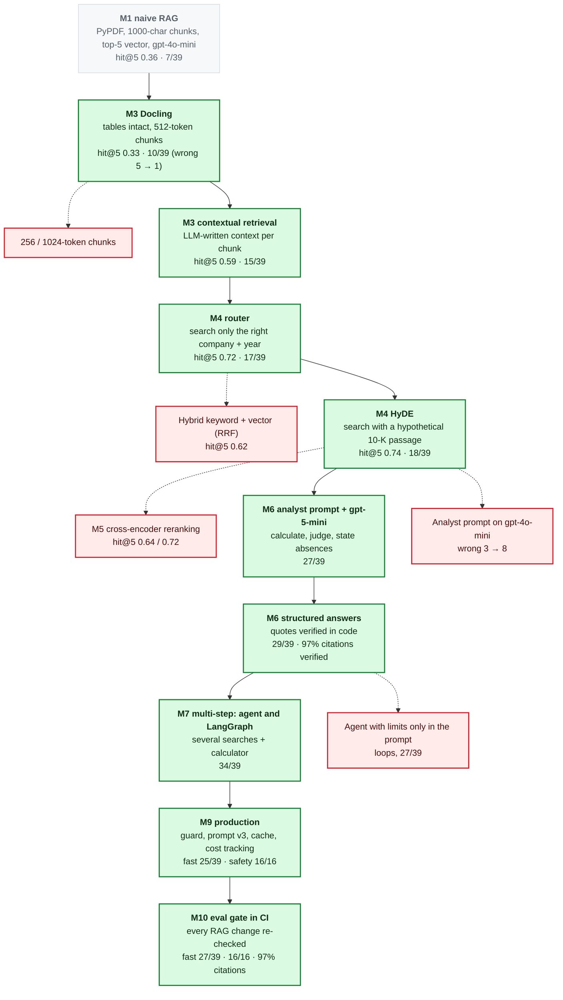

Solid arrows: the path that was kept. Dotted arrows: experiments that were tried and rejected.

## M1: the baseline

### 1. `m1_baseline` (M1) · Baseline

The naive baseline everything else is measured against.

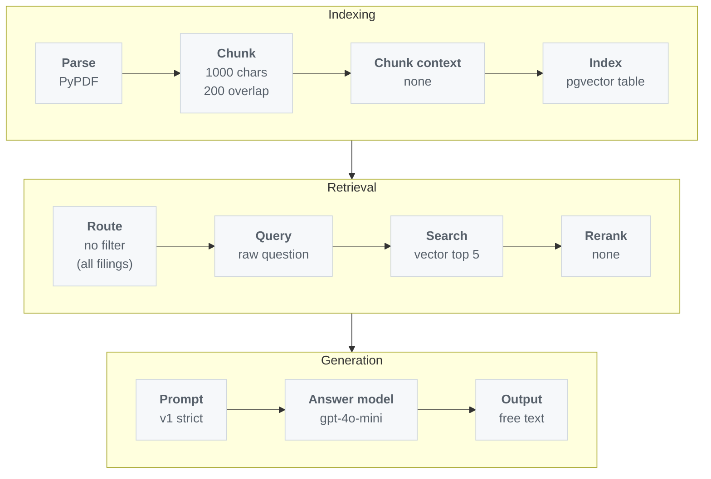

hit@5 0.359 · MRR 0.208 · 7/39 correct · answer score 0.231

## M3: better ingestion (runs 2-8)

### 2. `m3_docling` (M3) · Kept

Tables stay intact, so answers got more precise (wrong answers 5 → 1) although search itself did not improve yet.

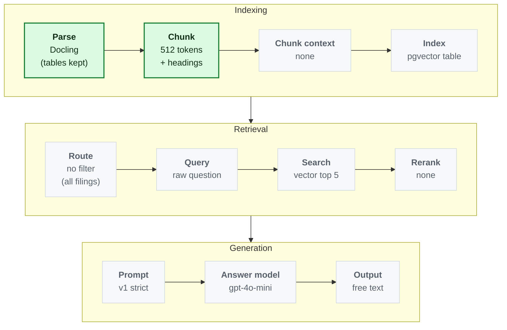

| Compared with `m1_baseline` | hit@5 | MRR | Correct / 39 | Answer score |
| --- | --- | --- | --- | --- |
| before | 0.359 | 0.208 | 7 | 0.231 |
| after | 0.333 | 0.227 | 10 | 0.321 |

### 3. `m3_docling_256` (M3) · Rejected

Smaller chunks lost context around numbers: no gain.

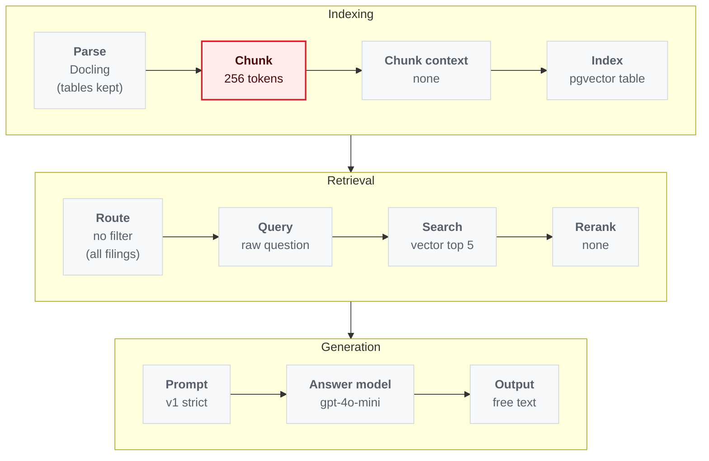

| Compared with `m3_docling` | hit@5 | MRR | Correct / 39 | Answer score |
| --- | --- | --- | --- | --- |
| before | 0.333 | 0.227 | 10 | 0.321 |
| after | 0.308 | 0.222 | — | — |

### 4. `m3_docling_1024` (M3) · Rejected

Bigger chunks diluted each embedding: worst ranking (MRR 0.175).


| Compared with `m3_docling` | hit@5 | MRR | Correct / 39 | Answer score |
| --- | --- | --- | --- | --- |
| before | 0.333 | 0.227 | 10 | 0.321 |
| after | 0.333 | 0.175 | — | — |

### 5. `m3_docling_noexh` (M3) · Kept

Pages after SIGNATURES removed: same quality, smaller and cleaner index.

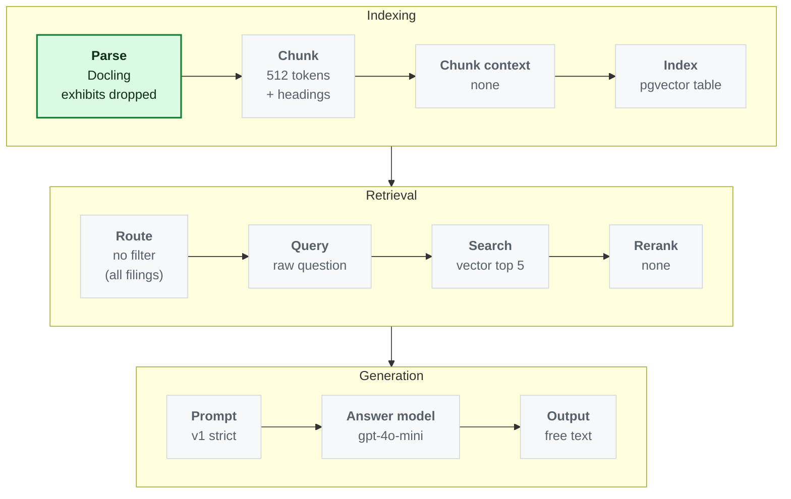

| Compared with `m3_docling` | hit@5 | MRR | Correct / 39 | Answer score |
| --- | --- | --- | --- | --- |
| before | 0.333 | 0.227 | 10 | 0.321 |
| after | 0.333 | 0.229 | 10 | 0.321 |

### 6. `m3_ctx_template` (M3) · Kept

Telling every chunk which company and year it belongs to: the first big search gain (hit@5 0.33 → 0.51).

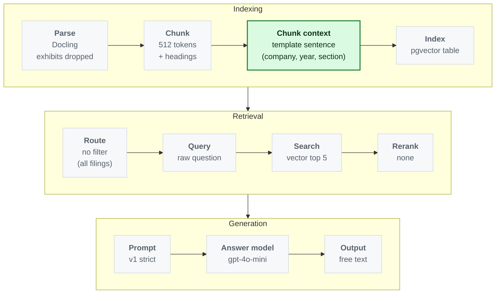

| Compared with `m3_docling_noexh` | hit@5 | MRR | Correct / 39 | Answer score |
| --- | --- | --- | --- | --- |
| before | 0.333 | 0.229 | 10 | 0.321 |
| after | 0.513 | 0.287 | — | — |

### 7. `m3_ctx_llm` (M3) · Kept

An LLM describes each chunk (contextual retrieval): hit@5 0.51 → 0.59, correct 10 → 15.

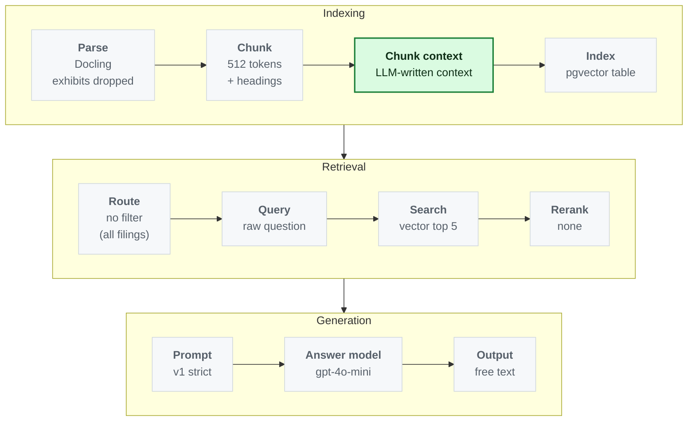

| Compared with `m3_ctx_template` | hit@5 | MRR | Correct / 39 | Answer score |
| --- | --- | --- | --- | --- |
| before | 0.513 | 0.287 | — | — |
| after | 0.590 | 0.372 | 15 | 0.474 |

### 8. `m3_live_check` (M3) · Kept

Same setup rebuilt with the Indexing API: identical numbers, now updatable without rebuilds.

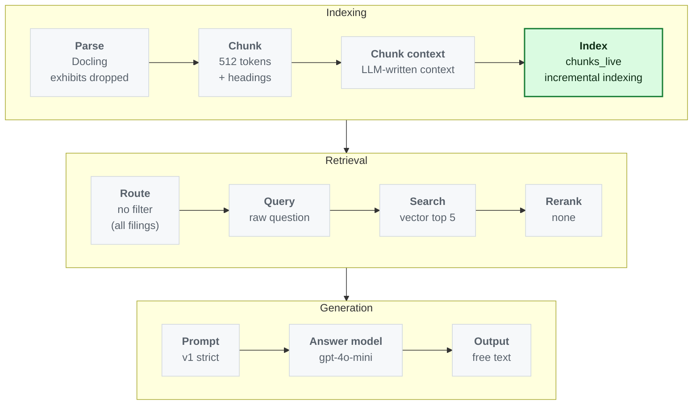

| Compared with `m3_ctx_llm` | hit@5 | MRR | Correct / 39 | Answer score |
| --- | --- | --- | --- | --- |
| before | 0.590 | 0.372 | 15 | 0.474 |
| after | 0.590 | 0.372 | — | — |

## M4: better retrieval (runs 9-12)

### 9. `m4_filters` (M4) · Kept, then fixed

Searching only the right filing (same_doc 0.69 → 0.92), but the router picked 2022 filings for 3 FY2021 questions.

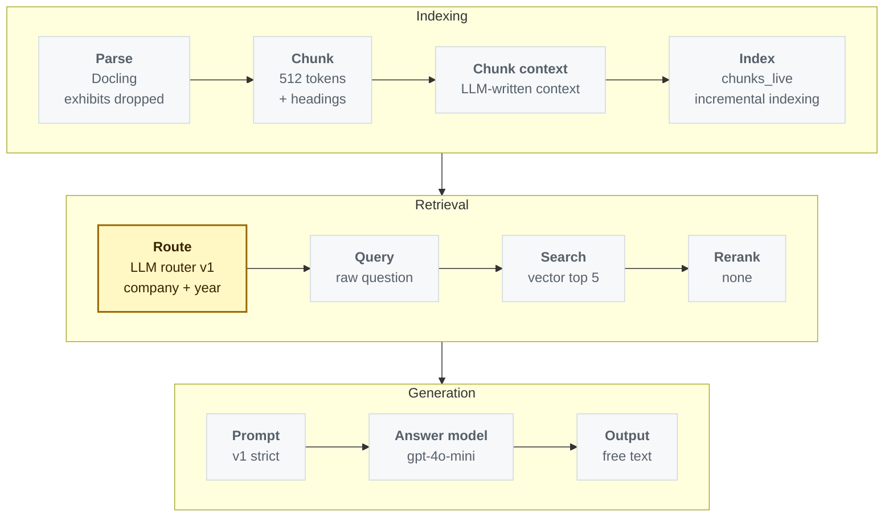

| Compared with `m3_live_check` | hit@5 | MRR | Correct / 39 | Answer score |
| --- | --- | --- | --- | --- |
| before | 0.590 | 0.372 | — | — |
| after | 0.641 | 0.357 | 14 | 0.449 |

### 10. `m4_filters_v2` (M4) · Kept

Router prompt fixed: 39/39 filings right, same_doc 1.0, hit@5 0.72.

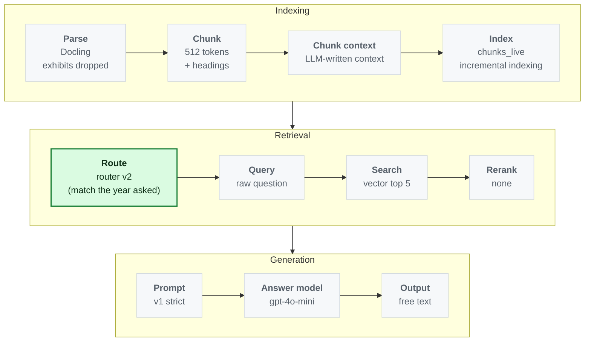

| Compared with `m4_filters` | hit@5 | MRR | Correct / 39 | Answer score |
| --- | --- | --- | --- | --- |
| before | 0.641 | 0.357 | 14 | 0.449 |
| after | 0.718 | 0.415 | 17 | 0.500 |

### 11. `m4_filters_hybrid` (M4) · Rejected

Keyword search on long, instruction-heavy questions added noise: hit@5 0.72 → 0.62.

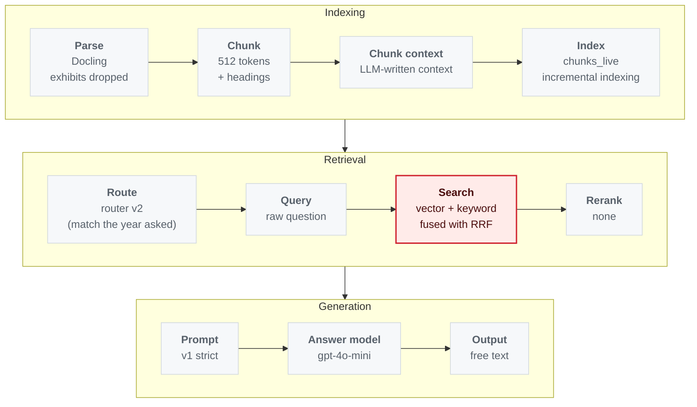

| Compared with `m4_filters_v2` | hit@5 | MRR | Correct / 39 | Answer score |
| --- | --- | --- | --- | --- |
| before | 0.718 | 0.415 | 17 | 0.500 |
| after | 0.615 | 0.381 | 15 | 0.436 |

### 12. `m4_filters_hyde` (M4) · Kept

Searching with a hypothetical 10-K paragraph: best ranking so far (MRR 0.42 → 0.49).

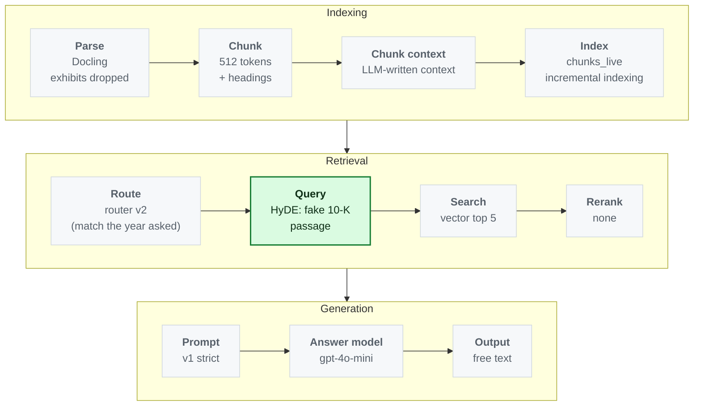

| Compared with `m4_filters_v2` | hit@5 | MRR | Correct / 39 | Answer score |
| --- | --- | --- | --- | --- |
| before | 0.718 | 0.415 | 17 | 0.500 |
| after | 0.744 | 0.488 | 18 | 0.526 |

## M5: reranking (runs 13-15)

### 13. `m5_default_check` (M5) · No change (noise check)

No change, re-run: hit@5 0.74 → 0.82 is HyDE's run-to-run variance, not an improvement.

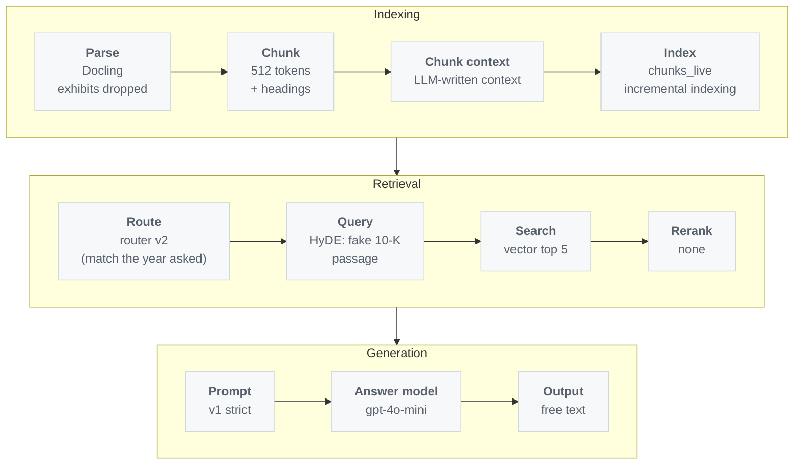

| Compared with `m4_filters_hyde` | hit@5 | MRR | Correct / 39 | Answer score |
| --- | --- | --- | --- | --- |
| before | 0.744 | 0.488 | 18 | 0.526 |
| after | 0.821 | 0.520 | — | — |

### 14. `m5_rerank_minilm` (M5) · Rejected

The small cross-encoder demoted good chunks: hit@5 0.82 → 0.64.

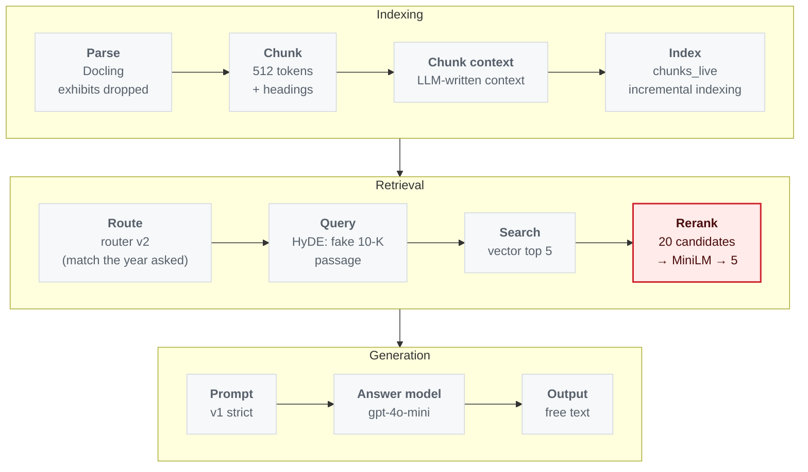

| Compared with `m5_default_check` | hit@5 | MRR | Correct / 39 | Answer score |
| --- | --- | --- | --- | --- |
| before | 0.821 | 0.520 | — | — |
| after | 0.641 | 0.404 | — | — |

### 15. `m5_rerank_bge` (M5) · Rejected

A bigger cross-encoder did better than MiniLM but still worse than no reranker.

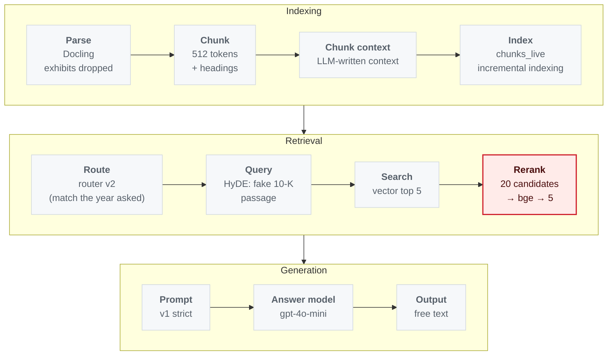

| Compared with `m5_default_check` | hit@5 | MRR | Correct / 39 | Answer score |
| --- | --- | --- | --- | --- |
| before | 0.821 | 0.520 | — | — |
| after | 0.718 | 0.414 | — | — |

## M6: better answers (runs 16-19)

From here the chunks are frozen (reused from run 12) so only the answer step changes; retrieval metrics stay the same and are shown as —.

### 16. `m6_v1_control` (M6) · No change (noise check)

Same chunks, prompt and model as run 12, answered again: 18 → 20 correct is generation noise (±2).


| Compared with `m4_filters_hyde` | hit@5 | MRR | Correct / 39 | Answer score |
| --- | --- | --- | --- | --- |
| before | 0.744 | 0.488 | 18 | 0.526 |
| after | — | — | 20 | 0.577 |

### 17. `m6_v2` (M6) · Rejected

The small model now tried calculations it could not do: refusals 11 → 3 but wrong 3 → 8.

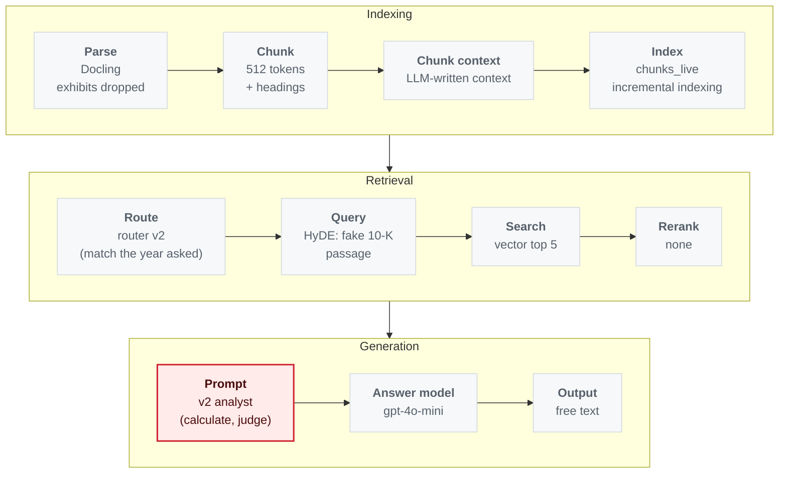

| Compared with `m6_v1_control` | hit@5 | MRR | Correct / 39 | Answer score |
| --- | --- | --- | --- | --- |
| before | — | — | 20 | 0.577 |
| after | — | — | 21 | 0.628 |

### 18. `m6_v2_gpt5mini` (M6) · Kept

Same prompt with a reasoning model: 20 → 27 correct without more wrong answers.

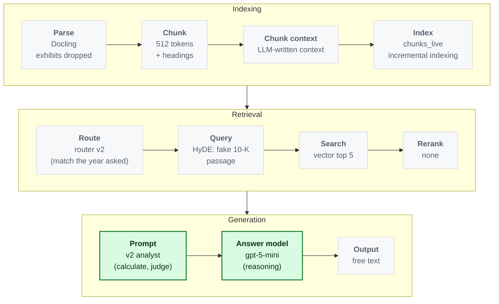

| Compared with `m6_v1_control` | hit@5 | MRR | Correct / 39 | Answer score |
| --- | --- | --- | --- | --- |
| before | — | — | 20 | 0.577 |
| after | — | — | 27 | 0.756 |

### 19. `m6_v2_structured` (M6) · Kept

Answers become checkable: 97% of quotes verified in code, quality unchanged (29 correct).

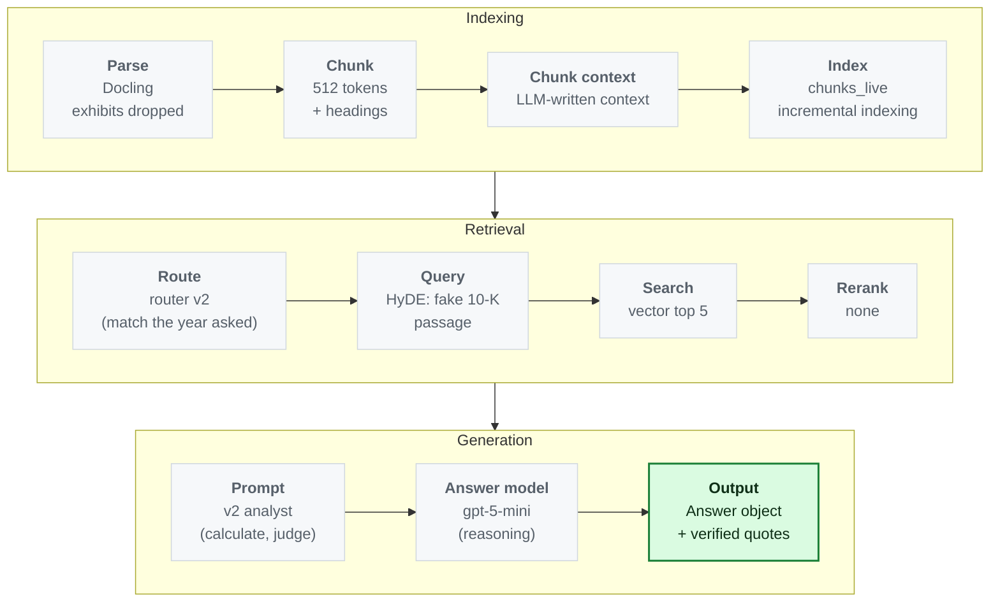

| Compared with `m6_v2_gpt5mini` | hit@5 | MRR | Correct / 39 | Answer score |
| --- | --- | --- | --- | --- |
| before | — | — | 27 | 0.756 |
| after | — | — | 29 | 0.769 |

## M7: multi-step retrieval (runs 20-23)

### 20. `m7_pipeline` (M7) · No change (noise check)

Run 19's setup end to end as M7's control: 24 correct (mostly correct → partial, judge noise).

```mermaid
flowchart TD
    subgraph ix["Indexing"]
        direction LR
        parse["<b>Parse</b><br/>Docling<br/>exhibits dropped"]:::same
        chunk["<b>Chunk</b><br/>512 tokens<br/>+ headings"]:::same
        context["<b>Chunk context</b><br/>LLM-written context"]:::same
        index["<b>Index</b><br/>chunks_live<br/>incremental indexing"]:::same
        parse --> chunk --> context --> index
    end
    subgraph rt["Retrieval"]
        direction LR
        route["<b>Route</b><br/>router v2<br/>(match the year asked)"]:::same
        query["<b>Query</b><br/>HyDE: fake 10-K<br/>passage"]:::same
        search["<b>Search</b><br/>vector top 5"]:::same
        rerank["<b>Rerank</b><br/>none"]:::same
        route --> query --> search --> rerank
    end
    subgraph gn["Generation"]
        direction LR
        prompt["<b>Prompt</b><br/>v2 analyst<br/>(calculate, judge)"]:::same
        model["<b>Answer model</b><br/>gpt-5-mini<br/>(reasoning)"]:::same
        output["<b>Output</b><br/>Answer object<br/>+ verified quotes"]:::same
        prompt --> model --> output
    end
    ix --> rt --> gn
    classDef same fill:#f6f8fa,stroke:#d0d7de,color:#57606a
    classDef chg_kept fill:#dafbe1,stroke:#1a7f37,stroke-width:2px,color:#0f2f17
    classDef chg_rejected fill:#ffebe9,stroke:#cf222e,stroke-width:2px,color:#4a0d0d
    classDef chg_partial fill:#fff8c5,stroke:#9a6700,stroke-width:2px,color:#3b2300
```

| Compared with `m6_v2_structured` | hit@5 | MRR | Correct / 39 | Answer score |
| --- | --- | --- | --- | --- |
| before | — | — | 29 | 0.769 |
| after | — | — | 24 | 0.718 |

### 21. `m7_agent` (M7) · Rejected

The fixed pipeline is replaced by a ReAct agent: gpt-5-mini decides what to search and when to calculate. Limits were only written in the prompt ("max 6 searches"), so on 8 answerable questions it kept searching until the step limit stopped it.

```mermaid
flowchart LR
    Q["<b>Question</b>"]:::same --> A["<b>Agent loop</b> (gpt-5-mini)<br/>think → call a tool → read"]:::rejected
    A --> S["<b>search_filings</b><br/>one filing, 5 chunks"]:::same --> A
    A --> C["<b>calculator</b><br/>exact arithmetic"]:::same --> A
    A --> O["<b>Answer object</b><br/>+ verified quotes"]:::same
    L["Limit only in the prompt:<br/>'max 6 searches'"]:::rejected -.-> A
    classDef same fill:#f6f8fa,stroke:#d0d7de,color:#57606a
    classDef kept fill:#dafbe1,stroke:#1a7f37,stroke-width:2px,color:#0f2f17
    classDef rejected fill:#ffebe9,stroke:#cf222e,stroke-width:2px,color:#4a0d0d
    classDef partial fill:#fff8c5,stroke:#9a6700,stroke-width:2px,color:#3b2300
```

| Compared with `m7_pipeline` | Correct / 39 | Wrong | Refused | Answer score | Time / answer |
| --- | --- | --- | --- | --- | --- |
| before | 24 | 4 | 3 | 0.718 | 25 s |
| after | 27 | 3 | 8 (all step-limit crashes) | 0.705 | 73 s |

### 22. `m7_agent_v2` (M7) · Kept (as `--agent`)

Same agent, but the search budget is enforced inside the tool ("Search limit reached. Answer now or refuse.") and the step limit is raised 25 → 40. The 8 crashes became 7 correct answers.

```mermaid
flowchart LR
    Q["<b>Question</b>"]:::same --> A["<b>Agent loop</b> (gpt-5-mini)<br/>think → call a tool → read"]:::same
    A --> S["<b>search_filings</b><br/>budget: 6 per question<br/>enforced in code"]:::kept --> A
    A --> C["<b>calculator</b>"]:::same --> A
    A --> O["<b>Answer object</b><br/>+ verified quotes"]:::same
    R["recursion limit 40<br/>tool calls logged"]:::kept -.-> A
    classDef same fill:#f6f8fa,stroke:#d0d7de,color:#57606a
    classDef kept fill:#dafbe1,stroke:#1a7f37,stroke-width:2px,color:#0f2f17
    classDef rejected fill:#ffebe9,stroke:#cf222e,stroke-width:2px,color:#4a0d0d
    classDef partial fill:#fff8c5,stroke:#9a6700,stroke-width:2px,color:#3b2300
```

| Compared with `m7_agent` | Correct / 39 | Wrong | Refused | Answer score | Time / answer |
| --- | --- | --- | --- | --- | --- |
| before | 27 | 3 | 8 | 0.705 | 73 s |
| after | **34** | 4 | 0 | **0.885** | 64 s |

### 23. `m7_graph` (M7) · Kept (as `--graph`, the accurate mode)

A fixed LangGraph workflow instead of a free agent: code decides the path, the LLM does one small job per box. Same accuracy as the agent, a predictable 4-6 LLM calls and the best citation accuracy (97%).

```mermaid
flowchart LR
    Q["<b>Question</b>"]:::same --> P["<b>plan</b> (gpt-4o-mini)<br/>facts needed + one search each"]:::kept
    P --> R["<b>retrieve</b> (code)<br/>no repeated searches"]:::kept
    R --> G{"<b>grade</b> (gpt-5-mini)<br/>all facts found?"}:::kept
    G -- "missing, retries left" --> R
    G -- "found / out of retries" --> C["<b>calculate</b><br/>LLM writes formulas,<br/>code computes"]:::kept
    C --> W["<b>generate</b> (gpt-5-mini)<br/>Answer + quotes"]:::same
    W --> K["<b>check</b> (code)<br/>no verified quote → refuse"]:::kept
    classDef same fill:#f6f8fa,stroke:#d0d7de,color:#57606a
    classDef kept fill:#dafbe1,stroke:#1a7f37,stroke-width:2px,color:#0f2f17
    classDef rejected fill:#ffebe9,stroke:#cf222e,stroke-width:2px,color:#4a0d0d
    classDef partial fill:#fff8c5,stroke:#9a6700,stroke-width:2px,color:#3b2300
```

| Compared with `m7_agent_v2` | Correct / 39 | Wrong | Refused | Citations verified | LLM calls | Time / answer |
| --- | --- | --- | --- | --- | --- | --- |
| agent v2 | 34 | 4 | 0 | 93% | ~6 | 64 s |
| graph | 34 | 3 | 1 | **97%** | 4.6 (4-6) | 61 s |

## M9: security rules in the prompt (run 24)

### 24. `m9_pipeline_v3` (M9) · Kept

Security rules cost no accuracy (score 0.718 = 0.718) and raised faithfulness 0.85 → 0.94.

```mermaid
flowchart TD
    subgraph ix["Indexing"]
        direction LR
        parse["<b>Parse</b><br/>Docling<br/>exhibits dropped"]:::same
        chunk["<b>Chunk</b><br/>512 tokens<br/>+ headings"]:::same
        context["<b>Chunk context</b><br/>LLM-written context"]:::same
        index["<b>Index</b><br/>chunks_live<br/>incremental indexing"]:::same
        parse --> chunk --> context --> index
    end
    subgraph rt["Retrieval"]
        direction LR
        route["<b>Route</b><br/>router v2<br/>(match the year asked)"]:::same
        query["<b>Query</b><br/>HyDE: fake 10-K<br/>passage"]:::same
        search["<b>Search</b><br/>vector top 5"]:::same
        rerank["<b>Rerank</b><br/>none"]:::same
        route --> query --> search --> rerank
    end
    subgraph gn["Generation"]
        direction LR
        prompt["<b>Prompt</b><br/>v3 = v2<br/>+ security rules"]:::chg_kept
        model["<b>Answer model</b><br/>gpt-5-mini<br/>(reasoning)"]:::same
        output["<b>Output</b><br/>Answer object<br/>+ verified quotes"]:::same
        prompt --> model --> output
    end
    ix --> rt --> gn
    classDef same fill:#f6f8fa,stroke:#d0d7de,color:#57606a
    classDef chg_kept fill:#dafbe1,stroke:#1a7f37,stroke-width:2px,color:#0f2f17
    classDef chg_rejected fill:#ffebe9,stroke:#cf222e,stroke-width:2px,color:#4a0d0d
    classDef chg_partial fill:#fff8c5,stroke:#9a6700,stroke-width:2px,color:#3b2300
```

| Compared with `m7_pipeline` | hit@5 | MRR | Correct / 39 | Answer score |
| --- | --- | --- | --- | --- |
| before | — | — | 24 | 0.718 |
| after | — | — | 25 | 0.718 |

## M9 safety: three layers of defence

```mermaid
flowchart LR
    Q["<b>Question</b>"] --> G{"<b>Input guard</b> (gpt-4o-mini)<br/>about a company?"}:::kept
    G -- "off-topic / prompt attack" --> D["Polite decline<br/>(1 cheap call)"]:::same
    G -- "filings question" --> C{"<b>Semantic cache</b><br/>same companies + years,<br/>similarity ≥ 0.95"}:::kept
    C -- hit --> O
    C -- miss --> P["Pipeline or graph<br/>answering with <b>prompt v3</b>:<br/>context is data, no invented numbers,<br/>no investment advice, canary"]:::kept
    P --> X{"<b>Output check</b> (code)<br/>canary or prompt text?"}:::kept
    X -- leak --> D
    X -- clean --> O["Answer + verified citations"]:::same
    classDef same fill:#f6f8fa,stroke:#d0d7de,color:#57606a
    classDef kept fill:#dafbe1,stroke:#1a7f37,stroke-width:2px,color:#0f2f17
    classDef rejected fill:#ffebe9,stroke:#cf222e,stroke-width:2px,color:#4a0d0d
    classDef partial fill:#fff8c5,stroke:#9a6700,stroke-width:2px,color:#3b2300
```

| Safety run | What changed | Attacks handled |
| --- | --- | --- |
| `m9_safety_baseline` | No defences | 12/16 |
| `m9_safety_defended` | Guard + prompt v3 + output check | 16/16 |
| `m9_safety_defended_v2` | Guard no longer blocks speculative questions about companies (it had blocked 3/45 real ones) | 15/16 (check misread a decline) |
| `m9_safety_defended_v3` | Fabrication check compares numbers with the sources | 15/16 (check misread a decline) |
| `m9_safety_defended_v4` | Advice check accepts "I can't give investment advice" | **16/16**, 0/45 real questions blocked |

## M10: the eval gate in CI

```mermaid
flowchart LR
    PR["Pull request<br/>changes RAG code"] --> PG["Temporary Postgres<br/>+ index restored<br/>from release asset"]
    PG --> G1["Guard on 45<br/>real questions"]:::kept
    PG --> G2["16 attacks"]:::kept
    PG --> G3["45-question<br/>scorecard (fast)"]:::kept
    G1 --> T{"All 6 checks<br/>within gate_baseline.json?"}
    G2 --> T
    G3 --> T
    T -- yes --> OK["✅ PR can merge"]:::kept
    T -- no --> NO["❌ PR blocked"]:::rejected
    classDef same fill:#f6f8fa,stroke:#d0d7de,color:#57606a
    classDef kept fill:#dafbe1,stroke:#1a7f37,stroke-width:2px,color:#0f2f17
    classDef rejected fill:#ffebe9,stroke:#cf222e,stroke-width:2px,color:#4a0d0d
    classDef partial fill:#fff8c5,stroke:#9a6700,stroke-width:2px,color:#3b2300
```

| Gate run | Guard blocked | Attacks | Correct / 39 | Wrong | Unanswerable declined | Citations | Result |
| --- | --- | --- | --- | --- | --- | --- | --- |
| `gate_local` | 0 | 16/16 | 27 | 3 | 83% | 93.8% | Failed: a correct decline was scored as a failure (scorer fixed) |
| `ci_1` (GitHub Actions) | 0 | 16/16 | 27 | 3 | 100% | 97.4% | **Passed** |
