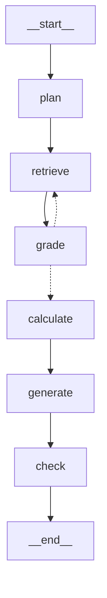

# M7: Agentic RAG

Completed: 2026-11-16 · Branch: `m7-agent`

**Goal:** answer questions that one search can't: inputs spread over several pages (income statement + cash flow statement), several filings (year-over-year), or exact arithmetic. Build it two ways, a free agent and a fixed graph, and measure both against the pipeline.

**Outcome:** both multi-step designs reach **34 of 39 correct** (answer score 0.885) against **24** for the pipeline re-run on the same day, with 0 to 1 refusals of answerable questions and all 6 unanswerable questions still refused. The cost is latency: ~61-64 s per answer vs ~25 s. **Default stays the pipeline** (fast); `--graph` is the accurate mode; `--agent` is kept as an option.

## Three ways to answer

```text
Pipeline (M6, default)       router -> HyDE -> 1 search (5 chunks) -> answer -> verify citations
                             fixed, 3 LLM calls, ~25 s

Agent (Part A, --agent)      gpt-5-mini loop: think -> search_filings / calculator -> read -> ... -> Answer
                             the LLM decides every step; limits in code (6 searches, 40 graph steps)

Graph (Part B, --graph)      plan -> retrieve -> grade --missing?--> retrieve (max 2 retries)
                                                     \--> calculate -> generate -> check
                             code decides the path; the LLM does one small job per box; 4-6 LLM calls
```

### Graph nodes

| Node | Done by | Job |
| --- | --- | --- |
| plan | gpt-4o-mini | List the facts needed and one search per fact (names the statement when the question does) |
| retrieve | code | Run searches inside one filing each, skip repeats, dedupe chunks |
| grade | gpt-5-mini | Which facts are still missing (synonyms count as found; wrong source counts as missing)? Write new, different searches |
| calculate | gpt-5-mini + code | LLM writes the formulas, the safe calculator computes them |
| generate | gpt-5-mini | Structured `Answer` with citations (M6 prompt) |
| check | code | Verify citations; an "answerable" answer with no verified quote becomes a refusal |



## Experiments (45 questions: 39 answerable + 6 unanswerable, full runs)

| Run | System | Correct | Partial | Wrong | Refused | Answer score | Faithfulness | Ctx precision | Ctx recall | Citations verified | Time / answer | Searches / q |
| --- | --- | --- | --- | --- | --- | --- | --- | --- | --- | --- | --- | --- |
| m7_pipeline | Pipeline (control, re-run) | 24 | 8 | 4 | 3 | 0.718 | 0.85 | 0.66 | 0.77 | 121/127 (95%) | 25 s | 1 |
| m7_agent | Agent, limits in the prompt only | 27 | 1 | 3 | 8 | 0.705 | 0.96 | 0.63 | 0.86 | 152/163 (93%) | 73 s | 2.4* |
| m7_agent_v2 | Agent, limits in code | **34** | 1 | 4 | 0 | **0.885** | 0.89 | 0.61 | 0.82 | 205/220 (93%) | 64 s | 3.3 |
| m7_graph | LangGraph workflow | **34** | 1 | 3 | 1 | **0.885** | 0.93 | 0.57 | 0.80 | 177/182 (97%) | 61 s | 3.9 |

\* on the 31 questions it finished. All runs: refusal accuracy 6/6. The graph used 4.6 LLM calls per question on average (27 questions: 4 calls, 9: 5, 9: 6).

## What we discovered

1. **Multi-step retrieval is the big win.** 24 → 34 correct. Calculations across two statements (PepsiCo EBITDA, Verizon and AMD quick ratios), "none" answers (AmEx securities) and segment questions all went from refused/partial to correct. Partial answers dropped 8 → 1: the system keeps searching until it has every input.
2. **An agent needs limits in code, not in the prompt.** The first agent run ignored "max 6 searches" and looped into the step limit on 8 answerable questions (5 of them simple lookups), and on 5 of the 6 unanswerable ones: those "refusals" were crashes, not decisions. A search budget inside the tool ("Search limit reached. Answer now or refuse.") fixed all 8: 27 → 34 correct, 0 crashes.
3. **Agent and graph are equally accurate; the graph is more controllable.** Same 34/39. The graph has a fixed range of LLM calls, a readable step log, no runaway loops and the best citation accuracy (97%). The agent is more flexible but its behaviour has to be fenced in.
4. **The grader is the most important step in the graph.** With gpt-4o-mini and a loose prompt it didn't recognise "operating profit" as "operating income", repeated the same searches and burned both retries, and the answer used D&A from a note instead of the cash flow statement (16.43% instead of 16.52%). Prompt rules (synonyms count, wrong source counts as missing), a "searches already run" list, no-repeat searches in code and gpt-5-mini for grading fixed it: 4 LLM calls and the right number.
5. **Multi-step is not cheap.** Both designs take ~2.5× the pipeline's time. The graph isn't faster than the agent: 3 of its 4-6 calls use gpt-5-mini, and the planner searches every fact up front (3.9 searches, ~14 chunks per question), which also lowers context precision (0.57).
6. **Strict grounding checks have a cost.** The graph's check step caught no bad answers but refused one correct one (Verizon retiree payments): the model stitched two table cells into one quote, so the word-for-word check failed.
7. **RAGAS faithfulness is noisy for calculated answers.** On the same 31 questions with identical verdicts, faithfulness moved 0.96 → 0.86 between agent runs: a computed number (16.52%) isn't in the text word for word, and only ~20 of 39 questions get a faithfulness score at all. Judge verdicts and code-checked citations are the metrics to trust.
8. **The control run mattered.** The pipeline re-run scored 24 correct vs 29 in M6 on the same setup (mostly correct → partial). Comparing against M6's number would have overstated the agent's gain.
9. **Still failing:** Boeing tax rate (sign convention, wrong everywhere), one 3M question judged wrong by both multi-step systems, and occasional partials on "explain the drivers" questions.

## Files added or changed

| File | Role |
| --- | --- |
| `src/finsight/agent/tools.py` | `make_tools(registry, log)`: `search_filings(query, company, fiscal_year)` (one filing, k=5, global `[n]` numbering, 6-search budget) and `calculator(expression)` (safe AST evaluator); every call logged |
| `src/finsight/agent/simple_agent.py` | `answer_with_agent()`: `create_agent` + tools + `ToolStrategy(Answer)` (retries on missing fields), `recursion_limit=40`, citations verified like M6 |
| `src/finsight/agent/graph.py` | `build_graph()` / `answer_with_graph()`: LangGraph `StateGraph` with plan, retrieve, grade, calculate, generate, check; max 2 retries; no repeated searches |
| `src/finsight/ask.py` | `--agent` (prints AGENT STEPS) and `--graph` (prints GRAPH STEPS + LLM calls) |
| `eval/run_answers.py` | `--agent`, `--graph`; saves tool calls / steps, searches, calculations, LLM calls; a failing question is saved as a refusal with `stopped` instead of killing the run; prints average time, searches, calculator and LLM calls |

## Concepts learned

- **Agent (ReAct loop):** the model reasons, calls a tool, reads the result and repeats until it can answer (`create_agent`, `@tool`).
- **Tool design:** small, well-described tools; validation and limits inside the tool, where the model can't ignore them.
- **Structured output for agents:** `ToolStrategy` (the answer is a tool call; validation errors go back to the model) vs provider-native JSON (no retry).
- **LangGraph:** `StateGraph`, a typed shared state, nodes as plain functions, conditional edges, bounded loops; `draw_mermaid()` for diagrams.
- **Corrective RAG pattern:** retrieve → grade → rewrite and retry → generate → grounding check.
- **Query decomposition:** split a question into the facts it needs, one search each.
- **Agent vs workflow trade-off:** flexibility vs predictability, cost and debuggability.
- **Model routing by step:** cheap model for planning, strong model for judging, calculating and answering.

## Gotchas

- `create_agent(response_format=Answer)` used provider-native structured output: a missing field (`answerable`) crashed the run with no retry. Use `ToolStrategy(Answer, handle_errors=True)`.
- `GraphRecursionError` is raised when the step limit is hit; catch it and keep the tool log, otherwise steps are counted as 0.
- `recursion_limit` counts graph steps, not LLM calls: one model call + one tool run = 2 steps.
- Prompt rules like "max 6 searches" are suggestions; enforce budgets in code.
- Agent and graph runs take 45-75 minutes for 45 questions; run them in a terminal and let them finish.
- Score files: `glob("scores_m7_agent_*")` also matches `m7_agent_v2`; match the timestamp too (`scores_<run>_2*.csv`).

## Next

M8: serve FinSight over a FastAPI streaming API with a React UI and LangSmith feedback, with the pipeline as the fast default and the graph as an "accurate" mode.
